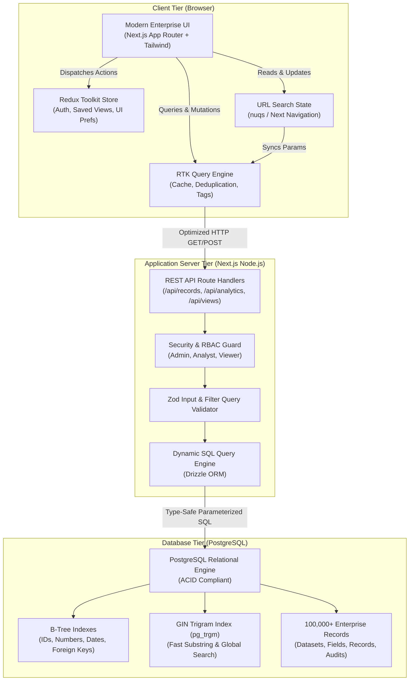
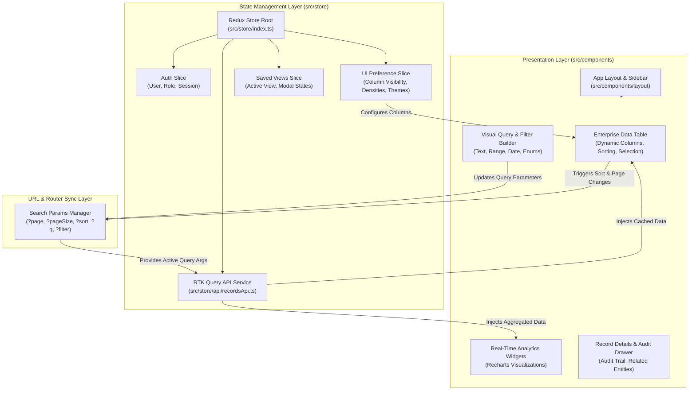
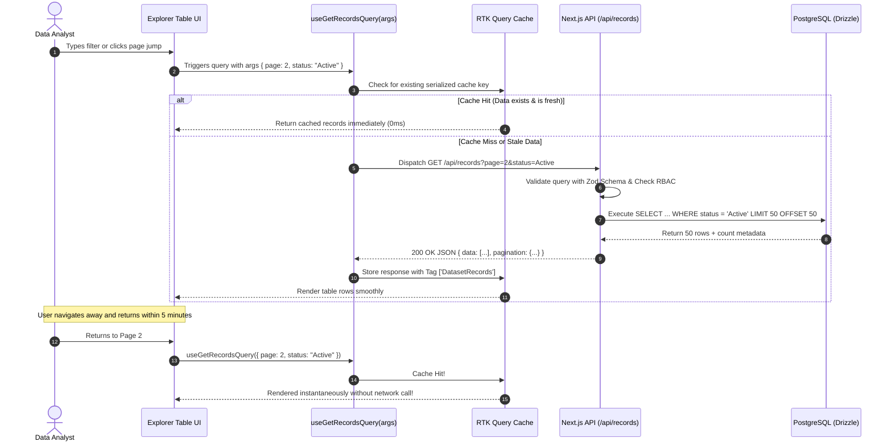
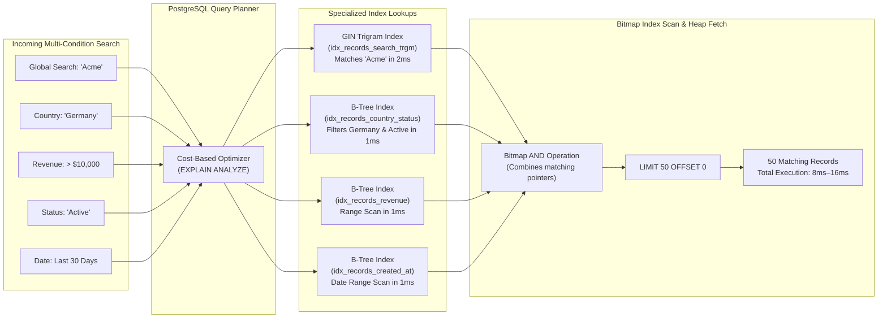

# DataScope – System & Frontend Architecture Documentation

This document provides in-depth architectural specifications and visual Mermaid diagrams for **DataScope – Enterprise Data Discovery & Intelligence Platform**.

---

## 1. System Overview Architecture

DataScope is structured as a high-throughput, multi-tiered enterprise data platform with strict separation of concerns across presentation, state coordination, query execution, and database indexing.



---

## 2. Frontend Architecture Diagram

The frontend is architected using a scalable, feature-first structure with strict state boundaries:



---

## 3. Data Fetching Flow Diagram (Server State vs. Client State)

The diagram below details the exact lifecycle of an analytical query, demonstrating how **RTK Query** prevents redundant API hits through automatic cache evaluation and request deduplication:



---

## 4. Large-Scale Search Architecture & Index Execution

How PostgreSQL processes multi-condition queries across **100,000+ records** without full table scans:



---

## 5. Directory & Feature-Based Folder Structure

The application follows the official Next.js App Router best-practice structure:

```text
datascope/
├── docs/                               # Comprehensive Technical Documentation
│   ├── ADR.md                          # 10 Architectural Decision Records
│   ├── ARCHITECTURE.md                 # System, Frontend & Search Architecture Diagrams
│   ├── DATABASE.md                     # Database ERD, Schema & Indexing Guide
│   ├── API.md                          # REST API Endpoints Specification
│   └── PERFORMANCE.md                  # 100k Records Benchmark & Performance Report
├── src/
│   ├── app/                            # Next.js App Router Pages & API Routes
│   │   ├── (auth)/                     # Auth routes (login, register)
│   │   ├── (dashboard)/                # Protected enterprise application routes
│   │   │   ├── explorer/               # Central Data Explorer page
│   │   │   ├── analytics/              # Aggregated Analytics page
│   │   │   ├── saved-views/            # Saved Views management page
│   │   │   ├── history/                # Search History page
│   │   │   ├── settings/               # System and User Preferences page
│   │   │   └── page.tsx                # Overview Dashboard
│   │   ├── api/                        # Backend REST API Endpoints
│   │   │   ├── records/                # Search, filter, paginate 100k records
│   │   │   ├── records/[id]/           # Individual record detail & audit trail
│   │   │   ├── datasets/               # Dataset management & statistics
│   │   │   ├── analytics/              # Server-side SQL aggregate calculations
│   │   │   ├── saved-views/            # CRUD for saved view configurations
│   │   │   └── export/                 # High-speed streaming CSV export
│   │   ├── layout.tsx                  # Root layout with Providers
│   │   └── page.tsx                    # Modern Enterprise Landing Page
│   ├── components/                     # Reusable UI & Feature Components
│   │   ├── table/                      # Enterprise Data Table (dynamic, sort, select)
│   │   ├── filters/                    # Visual Filter Builder & Condition Rows
│   │   ├── analytics/                  # Recharts Charts & Metric Cards
│   │   ├── layout/                     # Enterprise Sidebar, Header, User Menu
│   │   └── ui/                         # Base Atomic UI elements (Modal, Badge, Button)
│   ├── db/                             # Database Layer (Drizzle ORM)
│   │   ├── schema.ts                   # PostgreSQL Tables, Relations & Indexes
│   │   ├── index.ts                    # Database Pool Connection & Client
│   │   ├── seed.ts                     # 100,000 High-Speed Record Generator
│   │   └── migrations/                 # Drizzle SQL Migrations
│   ├── store/                          # Redux Toolkit Global State & RTK Query
│   │   ├── index.ts                    # Redux Store Configuration
│   │   ├── slices/                     # Client Slices (auth, ui, savedViews, search)
│   │   └── api/                        # RTK Query API Service Definitions
│   ├── types/                          # Shared TypeScript Interfaces & DTOs
│   └── lib/                            # Shared Utilities & Query Builders
└── drizzle.config.ts                   # Drizzle ORM Configuration
```

