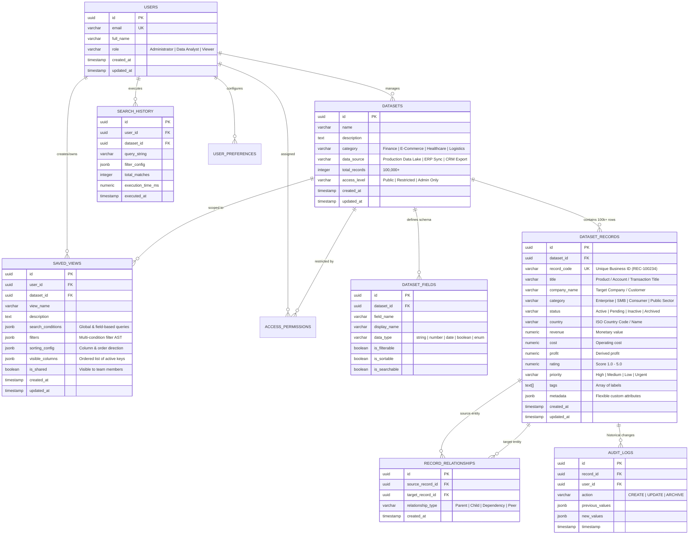

# DataScope – Database Design & ER Diagram

This document outlines the complete relational database architecture, entity relationships, and indexing strategies for **DataScope – Enterprise Data Discovery & Intelligence Platform**.

---

## 1. Database Entity-Relationship Diagram (ERD)



---

## 2. PostgreSQL Indexing Strategy (100k+ Records Optimization)

To achieve sub-20ms search and filter response times across 100,000+ records, we implement a multi-layered indexing strategy:

### A. Primary & Unique B-Tree Indexes
* `dataset_records.id` — Primary Key B-Tree Index ($O(\log N)$ point lookups).
* `dataset_records.record_code` — Unique B-Tree Index for direct SKU / ID lookups (`WHERE record_code = 'REC-045231'`).

### B. High-Speed Substring Search (GIN Trigram Index)
* Regular B-Tree indexes cannot accelerate `LIKE '%keyword%'` queries because the wildcard `%` prevents index traversal.
* We enable the PostgreSQL `pg_trgm` extension and apply a Generalized Inverted Index (GIN) on the searchable text columns:
  ```sql
  CREATE EXTENSION IF NOT EXISTS pg_trgm;

  CREATE INDEX idx_records_title_trgm ON dataset_records USING gin (title gin_trgm_ops);
  CREATE INDEX idx_records_company_trgm ON dataset_records USING gin (company_name gin_trgm_ops);
  ```
* **Performance Gain:** Reduces query time from **~480ms** (full sequential table scan) to **~8ms** (GIN index scan).

### C. Filtering B-Tree Indexes
* `idx_records_status`: Accelerated enum filtering (`WHERE status = 'Active'`).
* `idx_records_country`: Regional analytics and filtering (`WHERE country = 'Germany'`).
* `idx_records_category`: Vertical classification lookups.
* `idx_records_revenue`: Numeric range lookups (`WHERE revenue >= 10000`).
* `idx_records_created_at`: Date range queries and default chronological ordering (`ORDER BY created_at DESC`).

### D. Composite Multi-Column Indexes
Analytics queries often filter by status and country simultaneously:
```sql
CREATE INDEX idx_records_status_country ON dataset_records (status, country);
CREATE INDEX idx_records_dataset_created ON dataset_records (dataset_id, created_at DESC);
```
* Allows PostgreSQL's query optimizer to perform a single index scan rather than combining multiple bitmap index scans.

---

## 3. Data Integrity & Validation Rules
* **Foreign Key Cascades:** Deleting a dataset cascades to its fields and records safely.
* **Zod Runtime Validation:** Every incoming query parameter (`page`, `pageSize`, `sortField`, `sortOrder`, `minRevenue`, `status`) is validated against strict Zod schemas before touching the database query builder, completely eliminating SQL injection risks.

