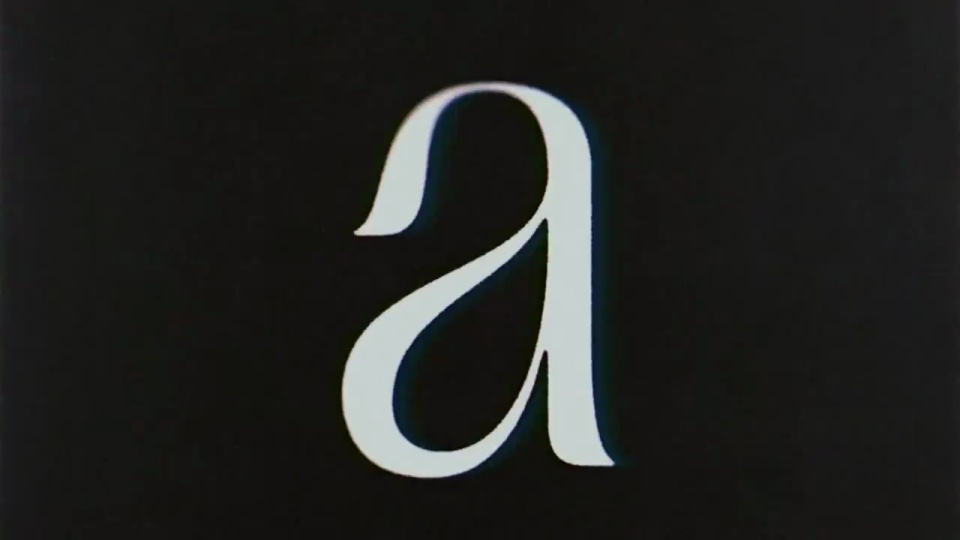

# Aesthetics

Build aesthetic expectations through designs first, then explain how that design is produced through specific edits. Boldly showcase visual differences in the first half, and shift focus to selection and editing in the second.

```motion-demo
{
  "id": "sequence",
  "title": "Overall choreography",
  "src": "demos/sequence.html",
  "duration": 54.2542,
  "status": "authored",
  "description": "Motion and composition example",
  "initialTime": 11.2,
  "params": [
    {
      "key": "title",
      "label": "Sample main copy",
      "type": "text",
      "value": "DESIGN PARTNER",
      "maxLength": 60
    },
    {
      "key": "accent",
      "label": "Accent color",
      "type": "color",
      "value": "#ed3b99"
    }
  ],
  "presets": [
    {
      "label": "Default content",
      "values": {
        "title": "DESIGN PARTNER",
        "accent": "#ed3b99"
      }
    },
    {
      "label": "OpenDesign adaptation",
      "values": {
        "title": "OpenDesign",
        "accent": "#7050da"
      }
    }
  ]
}
```

## Start with visual density, then show clear interactions

Open with rapid cuts through colors, materials, letterforms and layouts, giving each clip one visual focus. Slow down when entering the product to show requests, direction selection, annotations and revisions; viewers should be able to understand a complete change.

| Time | Section |
|---|---|
| 0.00–3.00s | Message on black |
| 3.00–10.00s | Rapid material and color cuts |
| 10.00–14.00s | Letterforms and image layers |
| 14.00–17.00s | Glowing button |
| 17.00–20.00s | Product positioning |
| 20.00–24.00s | Website designs |
| 24.00–30.00s | Request and direction selection |
| 30.00–38.00s | Annotated edits |
| 38.00–45.00s | Create a store |
| 45.00–49.00s | Finished page |
| 49.00–54.25s | Closing message reconnects with the opening |

## A black background supports highly saturated designs

Keep the background dark, using pink, blue and orange in designs and soft lighting areas. Display headings may vary boldly in weight, width and scale, while interface typography stays consistent and restrained.

Material close-ups may fill the frame; design cards retain their complete edges; inputs and annotations are smaller but must sit in a clear foreground layer.



## Different direction choices must produce different designs

After the design request, show distinguishable directions before the selection action. Respond to color, font and page-structure edits with the corresponding changes; do not repeatedly retitle the same design and present it as iteration.

```motion-demo
{
  "id": "clip-3",
  "title": "Different direction choices must produce different designs",
  "src": "demos/clip-3.html",
  "duration": 18,
  "status": "authored",
  "description": "20–38 seconds · Motion example",
  "initialTime": 0.6
}
```

## Return to the opening message at the end

Finish by showing complete website and store pages, then return to the opening text about design time. The ending gains its persuasive force from the creation process just shown.

When changing themes, prepare new design examples, requests and revision results together. Preserve the progression from aesthetic showcase to interaction evidence, with the brand mark serving only as the final signature.

## Color and typography

Sans-serif interface text with a clear size hierarchy.

#101013 · #ffffff · #ed3b99 · #778df2 · #fb6740

## Elements and production rules

Large heading / Material clips / Website cards / Input field / Option group / Annotations

- The first section builds aesthetic expectations through different design dimensions, and the second explains how they are achieved through actual interactions
- Alternate large design images with small input cards; show the corresponding revision only after the interaction
- The ending reconnects with the opening message about time to create contrast

## Content replacement

- When changing brands, replace the designs, prompts and revised results while preserving the aesthetic showcase → interaction evidence structure
- Replacing only the closing logo does not adapt the entire narrative

## Production parameters

[Visuals and objects](style.json) · [Section timing](timeline.json) · [Position data](tracks.json) · [File manifest](manifest.json)

This specification is based on the reference video. The HTML provides editable choreography examples; each file identifies the source, precision and valid interval of its data.

```motion-board
{
  "version": 1,
  "brand": "Lovable",
  "id": "V039",
  "palette": [
    "#101013",
    "#ffffff",
    "#ed3b99",
    "#778df2",
    "#fb6740"
  ],
  "typography": "Sans-serif interface text with a clear size hierarchy",
  "sample": "DESIGN PARTNER",
  "objects": [
    "Large heading",
    "Material clips",
    "Website cards",
    "Input field",
    "Option group",
    "Annotation"
  ],
  "frames": [
    {
      "path": "assets/reference-1.jpg",
      "timeSeconds": 0,
      "frameId": "K0001",
      "role": "reference-evidence",
      "status": "measured"
    },
    {
      "path": "assets/reference-2.jpg",
      "timeSeconds": 10.01,
      "frameId": "K0054",
      "role": "reference-evidence",
      "status": "measured"
    },
    {
      "path": "assets/reference-3.jpg",
      "timeSeconds": 17.017,
      "frameId": "K0090",
      "role": "reference-evidence",
      "status": "measured"
    },
    {
      "path": "assets/reference-4.jpg",
      "timeSeconds": 24.024,
      "frameId": "K0128",
      "role": "reference-evidence",
      "status": "measured"
    },
    {
      "path": "assets/reference-5.jpg",
      "timeSeconds": 38.038000000000004,
      "frameId": "K0183",
      "role": "reference-evidence",
      "status": "measured"
    },
    {
      "path": "assets/reference-6.jpg",
      "timeSeconds": 49.049,
      "frameId": "K0235",
      "role": "reference-evidence",
      "status": "measured"
    }
  ],
  "stages": [
    {
      "start": 0,
      "label": "Message on black",
      "end": 3,
      "status": "inferred",
      "basis": "Representative-frame review; approximate boundaries"
    },
    {
      "start": 3,
      "label": "Rapid material and color cuts",
      "end": 10,
      "status": "inferred",
      "basis": "Representative-frame review; approximate boundaries"
    },
    {
      "start": 10,
      "label": "Letterforms and image layers",
      "end": 14,
      "status": "inferred",
      "basis": "Representative-frame review; approximate boundaries"
    },
    {
      "start": 14,
      "label": "Glowing button",
      "end": 17,
      "status": "inferred",
      "basis": "Representative-frame review; approximate boundaries"
    },
    {
      "start": 17,
      "label": "Product positioning",
      "end": 20,
      "status": "inferred",
      "basis": "Representative-frame review; approximate boundaries"
    },
    {
      "start": 20,
      "label": "Website designs",
      "end": 24,
      "status": "inferred",
      "basis": "Representative-frame review; approximate boundaries"
    },
    {
      "start": 24,
      "label": "Request and direction selection",
      "end": 30,
      "status": "inferred",
      "basis": "Representative-frame review; approximate boundaries"
    },
    {
      "start": 30,
      "label": "Annotated edits",
      "end": 38,
      "status": "inferred",
      "basis": "Representative-frame review; approximate boundaries"
    },
    {
      "start": 38,
      "label": "Create a store",
      "end": 45,
      "status": "inferred",
      "basis": "Representative-frame review; approximate boundaries"
    },
    {
      "start": 45,
      "label": "Finished page",
      "end": 49,
      "status": "inferred",
      "basis": "Representative-frame review; approximate boundaries"
    },
    {
      "start": 49,
      "label": "Closing message reconnects with the opening",
      "end": 54.2542,
      "status": "inferred",
      "basis": "Representative-frame review; approximate boundaries"
    }
  ],
  "duration": 54.2542,
  "fontFamily": "Arial, sans-serif"
}
```
